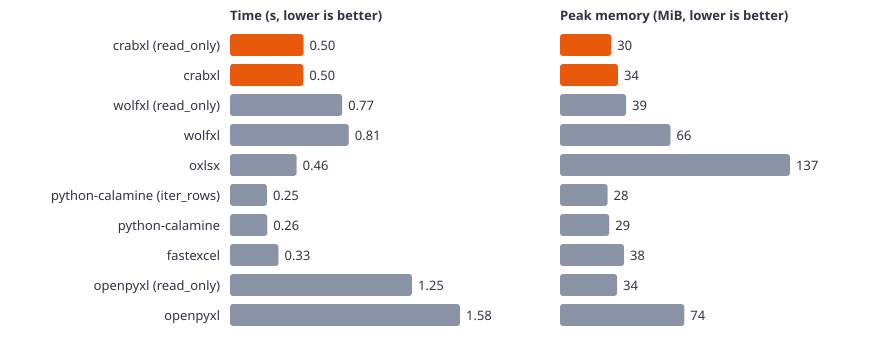
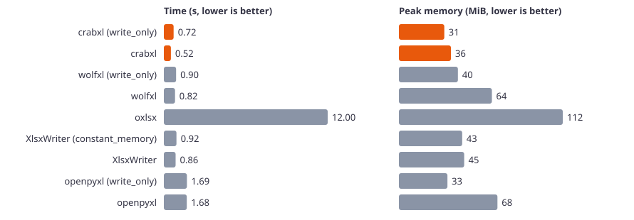
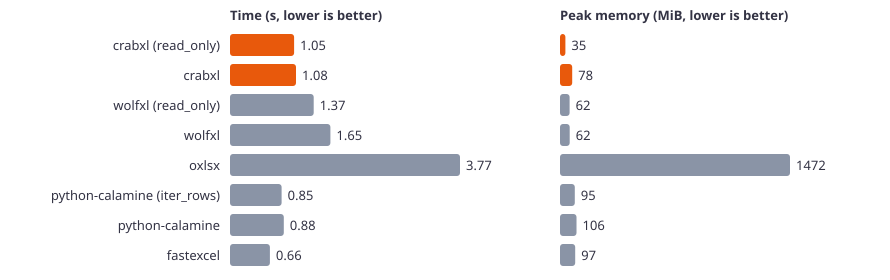
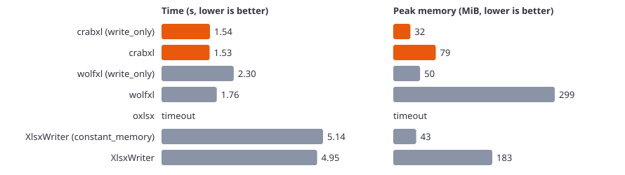
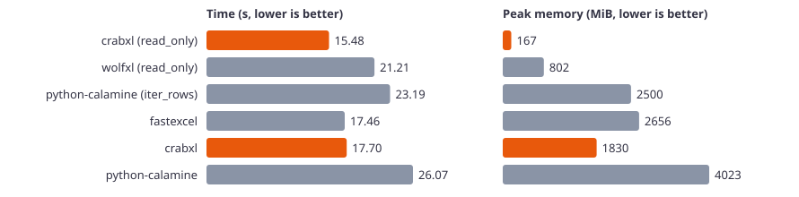

# Python benchmark results

Machine: Windows 11, AMD Ryzen 5 5600G with Radeon Graphics. Every library is pinned to the same single logical CPU. Median of 3 runs. Time is the wall time of the whole process. Memory is the peak resident memory of the process.

Python 3.15.2. crabxl 0.1.1, wolfxl 2.0.36, oxlsx 0.2.0, python-calamine 0.9.1, fastexcel 0.21.0, XlsxWriter 3.3.1, openpyxl 3.1.5.

## Read, small (10,000 rows × 10 columns, 1 MiB file)

| Library | Time (s) | CPU time (s) | Peak memory (MiB) |
|---|---:|---:|---:|
| crabxl (read_only) | 0.504 | 0.484 | 30.4 |
| crabxl | 0.502 | 0.469 | 34.5 |
| wolfxl (read_only) | 0.768 | 0.734 | 39.3 |
| wolfxl | 0.814 | 0.734 | 65.7 |
| oxlsx | 0.456 | 0.453 | 136.7 |
| python-calamine (iter_rows) | 0.253 | 0.219 | 28.3 |
| python-calamine | 0.256 | 0.234 | 29.3 |
| fastexcel | 0.332 | 0.297 | 38.0 |
| openpyxl (read_only) | 1.247 | 1.219 | 34.0 |
| openpyxl | 1.576 | 1.547 | 73.8 |

## Write, small (10,000 rows × 10 columns)

| Library | Time (s) | CPU time (s) | Peak memory (MiB) |
|---|---:|---:|---:|
| crabxl (write_only) | 0.716 | 0.578 | 31.1 |
| crabxl | 0.519 | 0.484 | 35.7 |
| wolfxl (write_only) | 0.898 | 0.828 | 40.4 |
| wolfxl | 0.818 | 0.781 | 63.8 |
| oxlsx | 12.004 | 11.984 | 112.4 |
| XlsxWriter (constant_memory) | 0.925 | 0.875 | 43.4 |
| XlsxWriter | 0.861 | 0.859 | 44.8 |
| openpyxl (write_only) | 1.689 | 1.641 | 33.3 |
| openpyxl | 1.681 | 1.625 | 67.6 |

## Edit, small (10,000 rows × 10 columns, 1 MiB file)

| Library | Time (s) | CPU time (s) | Peak memory (MiB) |
|---|---:|---:|---:|
| crabxl | 0.598 | 0.562 | 31.4 |
| wolfxl (modify) | 1.507 | 1.469 | 78.6 |
| oxlsx | 0.798 | 0.766 | 98.9 |
| openpyxl | 2.308 | 2.281 | 82.1 |

## Read, medium (100,000 rows × 10 columns, 6 MiB file)

| Library | Time (s) | CPU time (s) | Peak memory (MiB) |
|---|---:|---:|---:|
| crabxl (read_only) | 1.051 | 1.047 | 34.6 |
| crabxl | 1.082 | 1.047 | 78.0 |
| wolfxl (read_only) | 1.373 | 1.312 | 61.5 |
| wolfxl | 1.648 | 1.625 | 61.8 |
| oxlsx | 3.773 | 3.703 | 1472.3 |
| python-calamine (iter_rows) | 0.846 | 0.828 | 95.0 |
| python-calamine | 0.882 | 0.859 | 105.6 |
| fastexcel | 0.655 | 0.656 | 97.1 |

## Write, medium (100,000 rows × 10 columns)

| Library | Time (s) | CPU time (s) | Peak memory (MiB) |
|---|---:|---:|---:|
| crabxl (write_only) | 1.541 | 1.500 | 31.7 |
| crabxl | 1.531 | 1.484 | 78.7 |
| wolfxl (write_only) | 2.298 | 2.109 | 49.6 |
| wolfxl | 1.759 | 1.719 | 298.9 |
| oxlsx | > 120 (estimated from the smaller size) | – | – |
| XlsxWriter (constant_memory) | 5.140 | 5.078 | 42.5 |
| XlsxWriter | 4.953 | 4.906 | 183.3 |

## Edit, medium (100,000 rows × 10 columns, 6 MiB file)

| Library | Time (s) | CPU time (s) | Peak memory (MiB) |
|---|---:|---:|---:|
| crabxl | 2.069 | 2.031 | 39.0 |
| wolfxl (modify) | 4.514 | 4.438 | 444.6 |
| oxlsx | 12.356 | 12.219 | 1261.6 |

## Read, nyc311 (1,000,001 rows × 41 columns, 210 MiB file)

| Library | Time (s) | CPU time (s) | Peak memory (MiB) |
|---|---:|---:|---:|
| crabxl (read_only) | 15.476 | 14.531 | 166.7 |
| wolfxl (read_only) | 21.212 | 21.094 | 801.6 |
| python-calamine (iter_rows) | 23.185 | 23.141 | 2500.1 |
| fastexcel | 17.457 | 17.391 | 2656.3 |
| crabxl | 17.705 | 17.547 | 1830.1 |
| python-calamine | 26.070 | 25.891 | 4022.9 |
